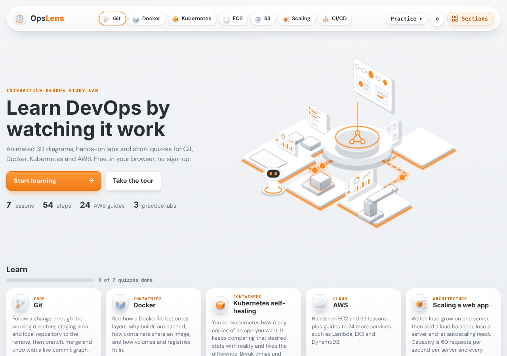
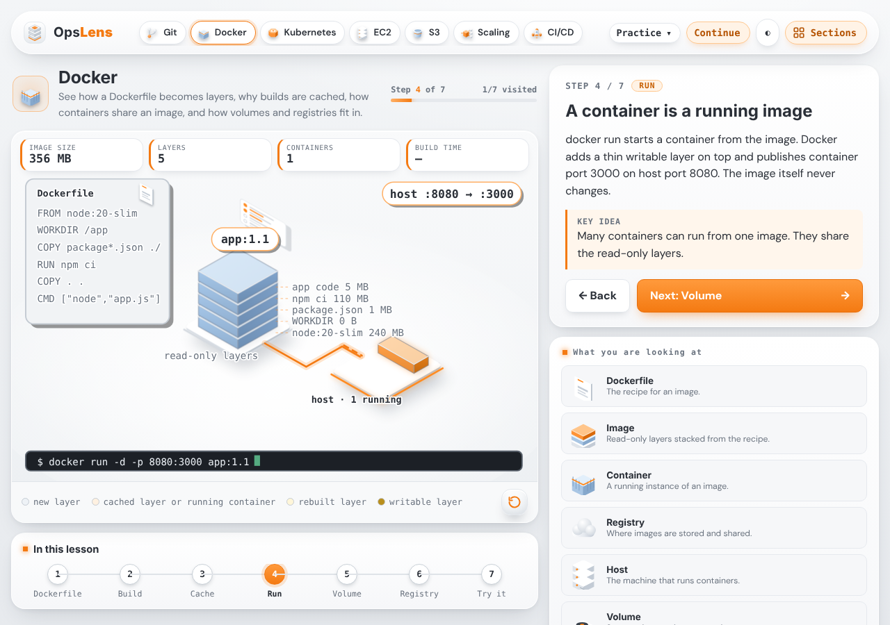
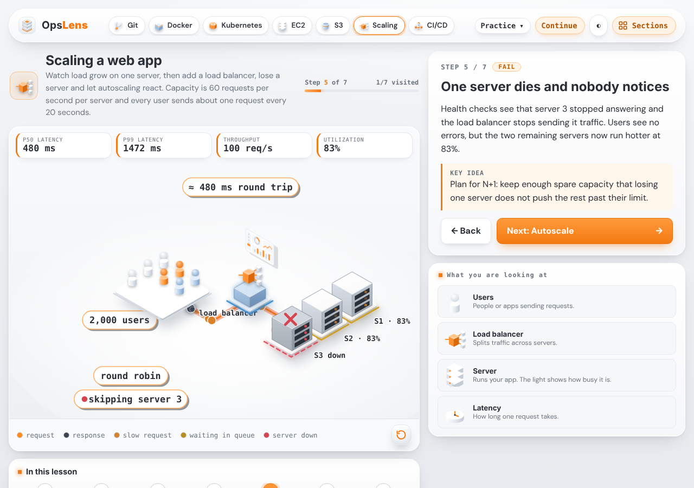

# OpsLens

**Learn DevOps by watching it work.** An interactive study site with animated 3D diagrams for Git, Docker, Kubernetes, AWS and CI/CD. Live demo: https://opslens-nine.vercel.app/



## What it has

| Feature | Details |
|---|---|
| 10 lessons, 71 steps | Git, Docker, Kubernetes, EC2, S3, Scaling, CI/CD, Networking, Terraform, Monitoring. Each step has a diagram that animates what really happens. |
| Practice terminals | Type real docker, kubectl and AWS CLI commands at the end of those lessons and get checked answers and hints. |
| Quick-check quizzes | Three questions per lesson, with a "review what you missed" summary and a progress bar on the home page. |
| Incident Room | An on-call game: read the alert, pick your first move, beat the clock. |
| Build Lab | Place infrastructure, send traffic through it and see latency and cost. |
| Git Practice | Type real git commands in a safe repo and watch the commit graph change. |
| 24 AWS guides | Short guides to services such as Lambda, EKS and DynamoDB. |
| Study notes | Download any lesson as Markdown or print it to PDF. |
| Themes | Matte clay light theme and a dark theme, saved in the browser. |




## How it is built

- Plain HTML, CSS and JavaScript. No framework, no build step, no dependencies.
- Every diagram is inline SVG drawn by a small isometric toolkit (boxes, platforms, pipes, packets) with SMIL animation.
- Strict Content-Security-Policy with no inline scripts, plus HSTS and other headers set in `vercel.json`.
- Respects `prefers-reduced-motion`, works at phone width, keyboard accessible.
- Progress is stored only in the browser (`localStorage`). No accounts, no tracking.

## What I learned

- How Git staging, branches and remotes fit together, and how to explain them visually.
- How Docker layers and caching work, and how containers differ from images.
- Load balancing, failure handling and N+1 capacity planning.
- Hardening a static site on Vercel: CSP, caching with version strings, header checks.
- Debugging SVG at scale (for example, duplicate gradient IDs silently washing out colours).

## Files

| File | What it does |
|---|---|
| `index.html` | The page shell. Loads the fonts, `style.css` and `app.js`. |
| `404.html`, `notfound.css` | Styled not-found page. |
| `og.png`, `apple-touch-icon.png` | Share preview and home-screen icon. |
| `style.css` | All styles, with light and dark themes. |
| `app.js` | All lessons, diagrams and the game. No inline scripts, so the strict security policy works. |
| `favicon.svg` | The OpsLens logo (rack and lens). |
| `robots.txt` | Lets search engines index the site. |
| `vercel.json` | Security headers and cache rules that Vercel applies to every response. |
| `scripts/check-headers.sh` | Checks a live URL and prints PASS or FAIL for each security header. |

## Deploy to Vercel (pick one)

**Option A: Vercel CLI (from this folder, on your computer)**

| Command | What it does |
|---|---|
| `npm i -g vercel` | Installs the Vercel command line tool. |
| `vercel login` | Signs you in through the browser. Nothing to type into the terminal. |
| `vercel` | Creates a preview deployment. Answer the questions; keep the defaults (no framework, no build command). |
| `vercel --prod` | Deploys to production. |

**Option B: Git import.** Push this folder to a repository you choose, then in the Vercel dashboard use Add New > Project > Import. Framework preset: Other. Leave Build Command and Output Directory empty.

**Option C: Dashboard upload.** Not available for plain folders on every plan, so use A or B.

## Verify the security headers after deploying

```bash
./scripts/check-headers.sh https://your-site.vercel.app
```

| Check | Why it matters |
|---|---|
| `Content-Security-Policy` | Blocks injected scripts. Only your own `app.js` may run. No inline scripts and no `eval`. |
| `Strict-Transport-Security` | Tells browsers to use HTTPS only for two years. |
| `X-Content-Type-Options: nosniff` | Stops the browser guessing file types. |
| `X-Frame-Options: DENY` and `frame-ancestors 'none'` | Stops other sites embedding yours (clickjacking). |
| `Referrer-Policy` | Sends only the site name to other sites, not full paths. |
| `Permissions-Policy` | Turns off camera, microphone, location and similar features. |
| `Cross-Origin-Opener-Policy` and `Cross-Origin-Resource-Policy` | Isolate the site from other origins. |
| `http://` redirect | Plain HTTP must redirect to HTTPS. |

Exit code is 0 when everything passes and 1 when something fails, so you can also run it in a CI pipeline.

## What the Content-Security-Policy allows

| Directive | Value | Reason |
|---|---|---|
| `default-src` | `'none'` | Block everything not listed below. |
| `script-src` | `'self'` | Only `/app.js` from your own site. |
| `style-src` | `'self' https://fonts.googleapis.com` | Your `style.css` and Google Fonts CSS. |
| `style-src-attr` | `'unsafe-inline'` | The diagrams set small `style="..."` values for animation delays. Scripts stay locked. |
| `font-src` | `https://fonts.gstatic.com` | The font files. |
| `img-src` | `'self' data:` | Favicon and inline images. |
| `connect-src` | `'self'` | No calls to other servers. |
| `frame-ancestors`, `object-src`, `base-uri`, `form-action` | `'none'` | Closes common attack paths. |

## Notes

- If you add analytics or another external script later, add its domain to `script-src` and `connect-src` in `vercel.json`, then redeploy and re-run the check.
- The `Strict-Transport-Security` header is set without `preload` on purpose. Preloading is hard to undo, so add it only when you are sure every subdomain will always use HTTPS.
- Progress and best score are saved in the visitor's own browser (localStorage). Nothing is sent anywhere.
- Prices in the AWS lessons are approximate. Check the AWS pricing page for current rates.
